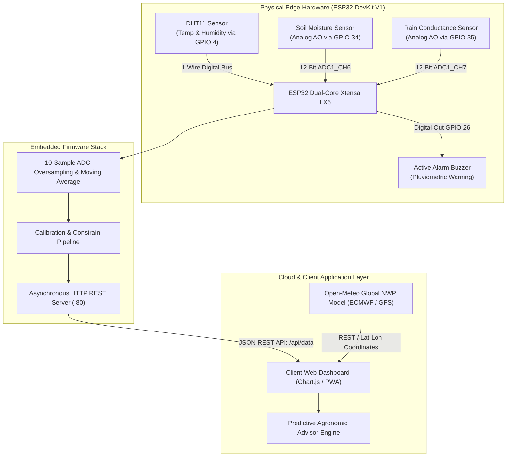

<p align="center">
  
</p>

# Autonomous Agro-Climatic Intelligence & Environmental Telemetry Platform
### High-Precision ESP32 Microclimate Sensing, Subsurface Hydrometry, Pluviometric Acoustic Alarm, and Predictive Synoptic Modeling

[](https://ankitsatnami.github.io/Smart_Environment_Monitor/)
[](https://github.com/Ankitsatnami/Smart_Environment_Monitor)
[](https://github.com/Ankitsatnami/Smart_Environment_Monitor)
[](https://github.com/Ankitsatnami)
[](LICENSE)

---

## 🔬 Project Overview & Abstract

The **Autonomous Agro-Climatic Intelligence & Environmental Telemetry Platform** is an integrated IoT hardware and software ecosystem authored and developed by **Ankit Satnami**. The system provides real-time in-situ microclimate sensing, subsurface soil hydration tracking, and automatic precipitation acoustic alerts via an **ESP32 DevKit V1** microcontroller, paired with a modern WebGL-accelerated telemetry dashboard.

Unlike conventional isolated data-loggers, this platform integrates edge sensor data (DHT11 temperature & relative humidity, 12-bit ADC soil volumetric water content, and pluviometric surface conductance) with **Open-Meteo numerical weather prediction (NWP) models**. A real-time **Rule-Based Agronomic Advisor Engine** fuses localized edge measurements with 48-hour forward precipitation vectors to deliver automated, data-driven irrigation and climate control recommendations.

- **Production Live Dashboard**: [https://ankitsatnami.github.io/Smart_Environment_Monitor/](https://ankitsatnami.github.io/Smart_Environment_Monitor/)
- **GitHub Repository**: [https://github.com/Ankitsatnami/Smart_Environment_Monitor](https://github.com/Ankitsatnami/Smart_Environment_Monitor)
- **Principal Author & Developer**: [Ankit Satnami](https://github.com/Ankitsatnami)

---

## 📐 System Architecture & Dataflow



---

## ⚡ Hardware Specifications & Pin Configuration

| Subsystem / Peripheral | Pin Assignment | Peripheral Type | Operating Voltage | Function & Signal Description |
| :--- | :---: | :---: | :---: | :--- |
| **DHT11 Sensor** | `GPIO 4` | Digital I/O | `3.3V - 5.0V` | Single-bus bidirectional serial data line (requires 4.7kΩ–10kΩ pull-up). |
| **Soil Moisture Sensor** | `GPIO 34` | Analog Input (`ADC1_CH6`) | `3.3V` | Analog voltage proportional to dielectric soil permittivity (12-bit ADC). |
| **Rain Conductance Plate** | `GPIO 35` | Analog Input (`ADC1_CH7`) | `3.3V` | Variable resistance bridge across serpentine traces (low analog = rain). |
| **Active Buzzer Alert** | `GPIO 26` | Digital Output | `3.3V - 5.0V` | Pluviometric threshold alarm (active-HIGH triggered on rain detection). |
| **Power Distribution** | `VIN` / `3V3` | Power Rails | `3.3V / 5.0V` | Regulated DC bus distribution to active transducers. |
| **Ground Reference** | `GND` | Common Ground | `0V` | Star-ground topology across all sensor modules. |

---

## 🧮 Mathematical & Algorithmic Formulations

### 1. Volumetric Soil Moisture Calibration
The analog voltage output from the soil moisture transducer is mapped to a standardized relative volumetric moisture percentage $\theta$ using dry-air and saturated-water reference calibration limits:

$$\theta = \text{constrain}\left(\frac{\text{ADC}_{\text{dry}} - \text{ADC}_{\text{raw}}}{\text{ADC}_{\text{dry}} - \text{ADC}_{\text{wet}}} \times 100,\ 0,\ 100\right)$$

*Where:*
* $\text{ADC}_{\text{dry}} = 3000$ counts (ambient dry air baseline).
* $\text{ADC}_{\text{wet}} = 1300$ counts (full saturation baseline).
* Input attenuation is set to `ADC_11db` accommodating full-scale $0 - 3.3\text{V}$ swing.

### 2. High-Frequency Noise Rejection (10-Sample Oversampling)
To suppress thermal Johnson-Nyquist noise and transient quantization jitter across the ADC channels, an oversampling kernel computes the discrete arithmetic mean:

$$\bar{X}_{\text{raw}} = \frac{1}{N} \sum_{i=0}^{N-1} x_i, \quad N=10, \quad \Delta t = 2\text{ms}$$

### 3. Pluviometric State Estimation
Precipitation state $S_{\text{rain}} \in \{0, 1\}$ is determined through discrete threshold comparison against the calibrated activation barrier:

$$S_{\text{rain}} = \begin{cases} 1 & \text{if } \text{ADC}_{\text{rain}} < \text{ADC}_{\text{threshold}} \quad (\text{Threshold} = 2500) \\ 0 & \text{otherwise} \end{cases}$$

Upon $S_{\text{rain}} = 1$, the micro-controller asserts a logic `HIGH` on `GPIO 26`, engaging the acoustic transducer.

---

## 🧠 Predictive Agronomic Advisor Rule Matrix

The embedded intelligence subsystem performs continuous multi-variable condition evaluation:

| Condition Vector | Threshold Parameters | Severity | Actionable Agronomic Recommendation |
| :--- | :--- | :---: | :--- |
| **Precipitation Prediction** | Rain Forecast $\ge 70\%$ within 48h & Soil Moisture $> 35\%$ | `WARNING` | **Suspend Irrigation**: Incoming precipitation will naturally recharge root zone; prevents water wastage and nutrient leaching. |
| **Soil Desiccation** | $\theta < 25\%$ | `DANGER` | **Immediate Irrigation Required**: Soil moisture has breached permanent wilting point. Deliver slow drip irrigation. |
| **Subsurface Waterlogging** | $\theta > 80\%$ or (Rain detected & $\theta > 70\%$) | `DANGER` | **Mitigate Saturated Root Zone**: Terminate all pumps and verify bed drainage to avert root hypoxia and anaerobic rot. |
| **Thermal Heat Stress** | $T_{\text{ambient}} > 35^\circ\text{C}$ & $\theta < 35\%$ | `DANGER` | **Heat Hazard Mitigation**: High temperature coupled with moisture deficit causes severe plant heat-shock. Deploy shading nets. |
| **High Humidity / Pathogen** | $\text{RH} > 85\%$ sustained | `WARNING` | **Ventilation Advisory**: High humidity creates favorable conditions for fungal sporulation (powdery mildew/botrytis). |
| **Telemetry Divergence** | $S_{\text{rain}} = 1$ & Rain Forecast $< 30\%$ | `WARNING` | **Micro-Rain Diagnostic**: Sensor detected moisture but regional forecast is dry. Likely localized cloudburst or surface condensation. |

---

## 📡 RESTful JSON Telemetry API (`GET /api/data`)

The ESP32 micro-webserver exposes an unauthenticated, low-latency REST endpoint with full Cross-Origin Resource Sharing (`CORS: *`) enabled:

### Endpoint: `GET http://<ESP32_IP>/api/data`
#### Response Schema:
```json
{
  "temperature": 27.4,
  "humidity": 62.1,
  "soilRaw": 1940,
  "rainRaw": 3820,
  "soilMoisture": 62,
  "raining": false,
  "dhtValid": true,
  "environment": "OPTIMAL_HOMEOSTASIS"
}
```

---

## 💻 Repository Structure

```
Smart_Environment_Monitor/
├── .github/
│   └── workflows/
│       └── deploy.yml          # Automated GitHub Pages CI/CD workflow
├── assets/
│   └── environmental_telemetry_hero.svg # High-definition animated architecture SVG
├── css/
│   └── style.css               # Modern industrial IoT dark theme
├── js/
│   └── app.js                  # Chart.js visualization, Open-Meteo fusion & advisor
├── firmware/
│   └── Smart_Environment_Monitor.ino # Production ESP32 firmware sketch
├── .gitignore                  # Git artifact exclusion rules
├── deploy_to_github.bat        # 1-Click Windows deployment script
├── deploy_to_github.ps1        # PowerShell GitHub REST API deployment engine
├── index.html                  # Responsive Web Telemetry Dashboard
├── LICENSE                     # MIT Open-Source License
└── README.md                   # Technical system documentation
```

---

## 🚀 Deployment & Installation

### 1. Firmware Upload (ESP32)
1. Open [`firmware/Smart_Environment_Monitor.ino`](firmware/Smart_Environment_Monitor.ino) in **Arduino IDE** or **PlatformIO**.
2. Install the requisite libraries via Library Manager:
   * `DHT sensor library` by Adafruit
   * `Adafruit Unified Sensor`
3. Configure your local Wi-Fi credentials in the configuration block:
   ```cpp
   const char* WIFI_SSID     = "Your_SSID";
   const char* WIFI_PASSWORD = "Your_Password";
   ```
4. Select board **ESP32 Dev Module** and flash via USB-UART port (`115200` baud).

### 2. Live Web Dashboard
* The web dashboard is continuously hosted on **GitHub Pages**:
  👉 **[https://ankitsatnami.github.io/Smart_Environment_Monitor/](https://ankitsatnami.github.io/Smart_Environment_Monitor/)**
* It operates in dual mode:
  1. **Interactive Demo / Simulation Mode**: Built-in dynamic telemetry engine for instantaneous testing, benchmarking, and review.
  2. **Direct Hardware Link**: Enter your ESP32's local IP address via the **"Configure IP"** dialog to bind the web dashboard directly to your live device.

---

## 👤 Author & Academic Credit

* **Lead Architect & Developer**: **Ankit Satnami**
* **GitHub Profile**: [@Ankitsatnami](https://github.com/Ankitsatnami)
* **Project Repository**: [https://github.com/Ankitsatnami/Smart_Environment_Monitor](https://github.com/Ankitsatnami/Smart_Environment_Monitor)

---

## 📖 Citation

If you utilize this project, its mathematical formulations, or its open-source firmware architecture in academic research, coursework, or IoT design, please cite it as:

```bibtex
@misc{satnami2026smartenv,
  author = {Satnami, Ankit},
  title = {Smart Environmental Monitoring & Agronomic Intelligence Platform: An Autonomous ESP32 Telemetry & Synoptic Forecast System},
  year = {2026},
  publisher = {GitHub},
  howpublished = {\url{https://github.com/Ankitsatnami/Smart_Environment_Monitor}}
}
```

---

## 📄 License

This project is licensed under the [MIT License](LICENSE) &copy; 2026 **Ankit Satnami**. All rights reserved for open academic and commercial innovation.